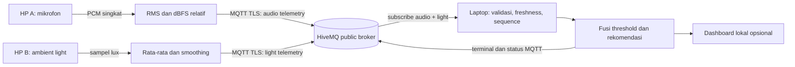

# StudyGuard

StudyGuard memantau kelayakan lingkungan belajar dari dua HP Android: HP A membaca mikrofon dan HP B membaca ambient light. Masing-masing edge mengolah data lokal dan hanya mengirim agregat melalui MQTT. Laptop menggabungkan telemetri serta menampilkan status dan rekomendasi.

> Status awal: belum diuji dengan HP fisik. Audit saat ini tidak menemukan `adb` atau Termux API pada laptop. Sensor HP B dan format audio HP A harus diperiksa mengikuti [`docs/HARDWARE_CHECK.md`](docs/HARDWARE_CHECK.md). Jangan gunakan hasil SIMULATION sebagai hasil perangkat nyata.

## Pemetaan ketentuan proyek

- Dua edge dan dua sensor: mikrofon HP A dan ambient light HP B.
- Processing 1 di HP A: RMS amplitudo PCM dan level relatif dBFS.
- Processing 2 di HP B: rata-rata beberapa sampel lux serta moving average.
- Keputusan terpisah di laptop: fusi threshold yang dapat dikonfigurasi.
- Komunikasi cloud: MQTT QoS 1, topic berdasarkan PROJECT_ID.
- Dashboard lokal opsional berjalan di laptop dan bind ke `0.0.0.0`.
- Tugas tambahan: isi keunikan ide, anggota kelompok, video, PPT, dan hasil pengamatan nyata sebelum pengumpulan.



## Prasyarat dan audit hardware

- Dua HP Android, WiFi/hotspot bersama, internet, laptop Python 3.10+.
- Termux dan Termux:API yang kompatibel dari sumber yang sama.
- HP A harus bisa menyediakan klip pendek yang benar-benar WAV PCM 16-bit mono untuk adapter saat ini. Termux:API dapat berbeda antarperangkat; ikuti pemeriksaan aktual dan alternatif `AudioRecord` pada panduan hardware.
- HP B harus memiliki ambient light sensor yang terbaca. Sensor, unit, dan nama harus diverifikasi; brightness layar bukan sensor lux.
- Izin mikrofon diperlukan untuk HP A. Tidak ada audio mentah yang dikirim; buffer/berkas sementara dihapus.

Ringkasan audit laptop dan status blokir tersedia di [`docs/FEASIBILITY.md`](docs/FEASIBILITY.md).

## Instalasi Windows

Dari PowerShell pada folder `studyguard`:

```powershell
python -m venv .venv
.\.venv\Scripts\Activate.ps1
python -m pip install -r requirements.txt
Copy-Item .env.example .env
```

Edit `.env`: buat `PROJECT_ID` unik untuk kelompok, sesuaikan nilai ambang hasil kalibrasi, lalu atur kredensial jika memakai broker privat. Jangan commit `.env`. Nilai awal ambang hanya demo, bukan standar kesehatan/pencahayaan resmi. `NOISE_THRESHOLD_DBFS` harus dikalibrasi terhadap mikrofon dan baseline ruangan. `LIGHT_THRESHOLD_LUX` merupakan ambang demo yang disepakati kelompok.

## Jalankan sistem

Pastikan ketiga perangkat menggunakan PROJECT_ID dan broker yang sama. HiveMQ publik tidak memerlukan proses broker lokal; ia layanan internet bersama untuk demo. Gunakan TLS dengan default port 8883. Bila jaringan gagal TLS, diagnosa koneksi/sertifikat dan jangan menurunkan TLS diam-diam. Broker publik tidak menjamin privasi, ketersediaan, atau pesan tersimpan; jangan kirim data pribadi.

Jalankan detector pada laptop:

```powershell
python -m detector.main
```

Salin folder `studyguard` ke penyimpanan HP (misalnya USB), lalu di Termux jalankan `termux-setup-storage`, izinkan akses penyimpanan dan salin folder ke `~/studyguard`. Instal Python/dependensi pada kedua HP:

```sh
pkg update
pkg install python
cd ~/studyguard
python -m pip install -r requirements.txt
cp .env.example .env
```

Edit `.env` di kedua HP: gunakan PROJECT_ID sama dengan laptop; di HP B ubah `LIGHT_SENSOR_NAME` sesuai hasil `termux-sensor -l`. Izinkan mikrofon di pengaturan Android bila diminta. Kemudian:

```sh
python -m edge.audio_edge
```

Pada HP B, isi `LIGHT_SENSOR_NAME` di `.env` dengan nama sensor yang lolos pemeriksaan, lalu:

```sh
python -m edge.light_edge
```

Edge nyata akan berhenti dengan error bila sensor/perintah/format tidak cocok. Ia tidak otomatis mengganti data dengan simulasi.

Untuk memeriksa jalur pesan dan rules tanpa HP, jalankan **secara eksplisit** pengirim simulasi dari mesin yang memiliki salinan proyek:

```powershell
python -m edge.simulator --noise -45 --lux 450 --count 5
```

Terminal dan payload akan menandai `SIMULATION`. Untuk menguji status lain, ubah `--noise` dan `--lux`; jangan menyajikannya sebagai pengukuran nyata.

Dashboard (opsional) ikut berjalan bersama detector. Dari laptop gunakan `http://127.0.0.1:8000`; dari HP di jaringan yang sama gunakan `http://<IP-LAN-laptop>:8000`. Firewall Windows mungkin memerlukan aturan jaringan lokal. Akses lintas perangkat belum diuji; pastikan manual dan jangan klaim berhasil sebelum dibuka dari perangkat kedua.

## Ambang, freshness, dan status

Secara default data lebih tua dari 15 detik menjadi tidak tersedia. Sequence duplicate/out-of-order, payload invalid, mode selain REAL/SIMULATION, timestamp masa depan, dan rentang nilai yang salah ditolak. Status tidak akan IDEAL bila salah satu edge offline/stale. Data REAL dan SIMULATION yang tercampur menjadi INCOMPLETE_DATA.

Status: `IDEAL`, `TOO_NOISY`, `TOO_DARK`, `NOT_CONDUCIVE`, `INCOMPLETE_DATA`. dBFS menggambarkan amplitudo digital relatif, bukan dB SPL terkalibrasi. Hasil dipengaruhi posisi HP, gain/perangkat, lingkungan, dan orientasi sensor.

## Pengujian lokal

```powershell
python -m unittest discover -s tests -v
```

Ini menguji fungsi dan validasi dengan data sintetis saja. Uji manual perangkat, pemulihan koneksi MQTT, dan akses dashboard LAN belum dijalankan; lihat [`docs/TEST_PLAN.md`](docs/TEST_PLAN.md) dan tabel hasil.

## Troubleshooting

- `termux-sensor` tidak ditemukan: pasang Termux:API dan aplikasi pendamping yang kompatibel, lalu periksa PATH/izin.
- Sensor cahaya tidak terdaftar: status `BLOCKED_HARDWARE`; pilih HP lain atau sepakati rancangan baru.
- Audio bukan WAV PCM 16-bit mono: adapter menolak format. Verifikasi kemampuan aktual; bila tidak tersedia, jalur alternatif adalah aplikasi Android `AudioRecord` yang menghitung RMS lokal dari mikrofon fisik.
- MQTT timeout/TLS error: cek internet, host, port/TLS, waktu sistem dan CA certificates. Jangan downgrade TLS secara otomatis.
- Tidak muncul data: PROJECT_ID/topic harus sama; subscription detector menggunakan `studyguard/<PROJECT_ID>/...`.

## Dokumen tugas

- [`docs/ARCHITECTURE.md`](docs/ARCHITECTURE.md)
- [`docs/TEST_PLAN.md`](docs/TEST_PLAN.md)
- [`docs/DEMO_SCRIPT.md`](docs/DEMO_SCRIPT.md)
- [`docs/PPT_OUTLINE.md`](docs/PPT_OUTLINE.md)
- [`docs/RESULTS_TEMPLATE.md`](docs/RESULTS_TEMPLATE.md)
